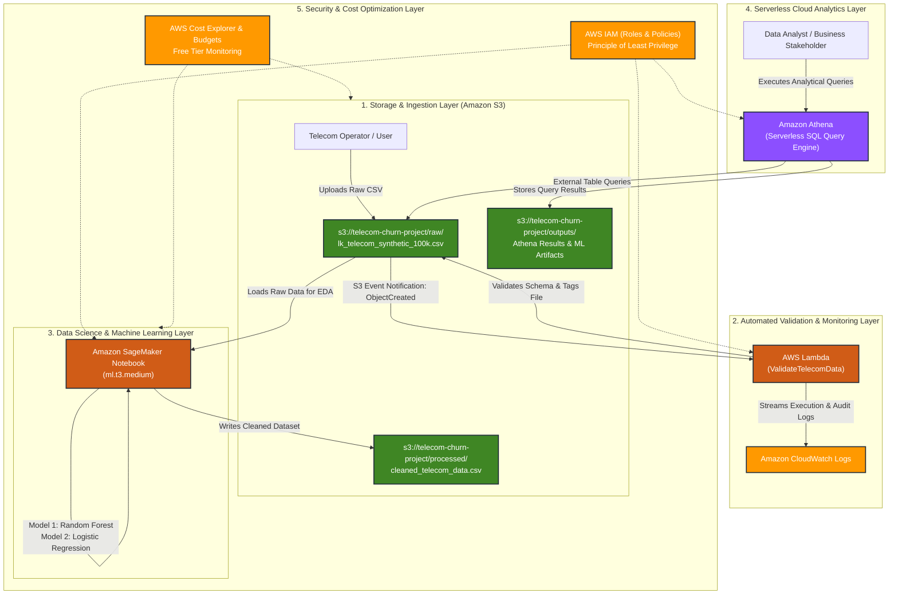

# AWS Cloud Architecture Diagram

---

## Architecture Flow Summary

1. **Ingestion & Validation**:
   - Customer dataset is ingested into `s3://telecom-churn-project/raw/`.
   - S3 triggers an asynchronous **AWS Lambda** function.
   - The Lambda function validates schema integrity without loading the entire 100k-row payload into memory, logging errors/success to **Amazon CloudWatch** and tagging the object with `Status=Validated`.

2. **Data Science & ML Pipeline**:
   - **Amazon SageMaker** pulls the validated data.
   - Exploratory Data Analysis (EDA) and data transformations are executed.
   - Two ML classification models (**Random Forest** and **Logistic Regression**) are trained, evaluated, and compared on classification metrics (Accuracy, Precision, Recall, F1).
   - Cleaned, normalized data is written back to `s3://telecom-churn-project/processed/`.

3. **Serverless Analytical SQL**:
   - **Amazon Athena** connects to the dataset using AWS Glue / external schema.
   - 5 business-critical SQL queries evaluate churn drivers: complaint resolution times, recharge inactivity gaps, overdue billing patterns, and operator market shares.
   - Query outputs are persisted in `s3://telecom-churn-project/outputs/`.

4. **Security & Cost Governance**:
   - **AWS IAM** strictly controls access across S3, Lambda, and SageMaker.
   - Zero-cost / Free Tier architectural boundaries are enforced: serverless compute (Lambda, Athena) and on-demand ML notebook lifecycle management.
