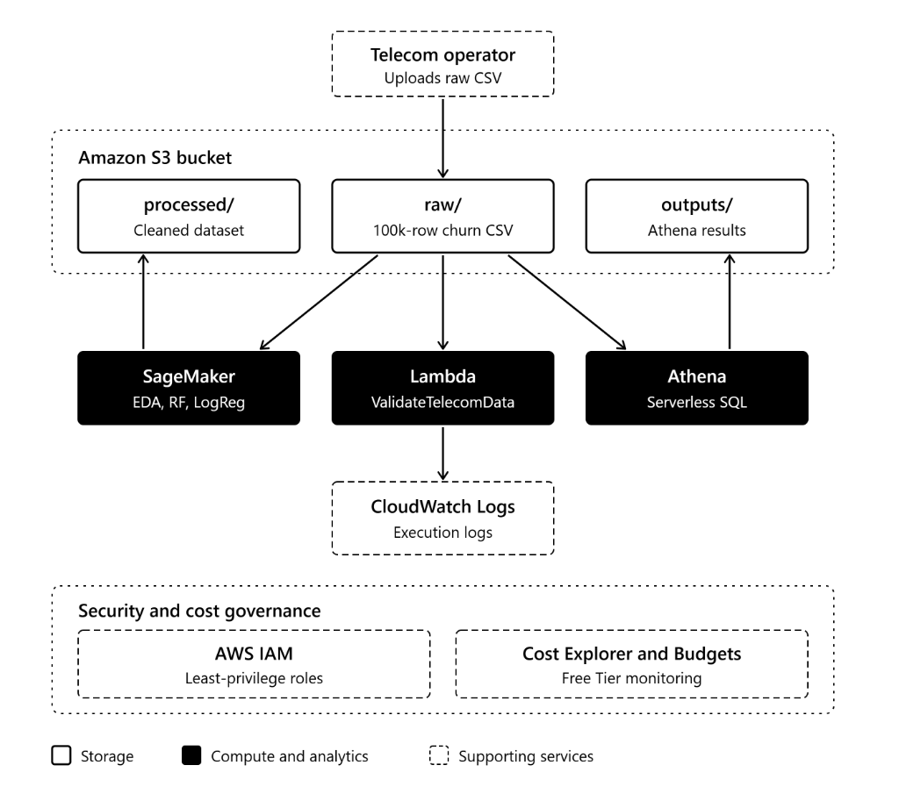

# AWS-BASED DATA SCIENCE GROUP PROJECT: TECHNICAL REPORT
## Customer Churn Prediction and Cloud Analytics Solution
**Target Domain**: Sri Lankan Telecommunications Industry (Dialog, SLT-Mobitel, Hutch)  
**Dataset Volume**: 100,500 Records across 54 Attributes  
**Primary Cloud Platform**: Amazon Web Services (AWS)  
**Authoring Group**: Group of 4 Students  

---

## 1. Executive Summary
In highly saturated telecommunications markets like Sri Lanka, customer retention is paramount. With prepaid subscriptions accounting for over 80% of active connections and high price sensitivity across Dialog Axiata (63.35% clean market share), SLT-Mobitel (22.42%), and Hutch (12.21%), subscribers face zero switching barriers. Acquiring new subscribers is between 5 to 7 times more costly than retaining existing customers.

This project delivers an enterprise-grade, cloud-native customer churn prediction and business intelligence solution entirely built upon Amazon Web Services (AWS). The end-to-end architecture integrates:
1. **Amazon S3** as an automated, multi-tiered data lake (`raw/`, `processed/`, `outputs/`).
2. **AWS Lambda and Amazon CloudWatch** for event-driven serverless schema validation and operational audit logging.
3. **Amazon SageMaker** for comprehensive Exploratory Data Analysis (EDA), automated data preprocessing, and training two machine-learning classification models (Random Forest and Logistic Regression).
4. **Amazon Athena** for serverless SQL analytics over 100,000 customer records.

The entire solution operates strictly within the AWS Free Tier and complies with the Principle of Least Privilege using AWS Identity and Access Management (IAM).

---

## 2. Cloud Architecture & Service Selection Justification

### 2.1 Architecture Overview
The system architecture follows a decoupled, serverless-first design pattern. 

*Figure 1: End-to-End AWS Cloud Architecture Diagram*

### 2.2 AWS Services Justification
- **Amazon S3**: Centralized object storage. Its 99.999999999% durability, fine-grained bucket policies, and native event triggers make it the optimal choice for tiered data lake management (`raw/`, `processed/`, `outputs/`).
- **AWS Lambda**: Eliminates idle server costs by executing validation logic on-demand within milliseconds of file upload. Integrated with S3 Event Notifications, it provides real-time data gatekeeping without maintaining EC2 servers.
- **Amazon CloudWatch**: Provides central observability, capturing runtime execution metrics, info/error logs, and audit trails for automated compliance and troubleshooting.
- **Amazon SageMaker**: Managed Jupyter notebook environment (`ml.t3.medium`) equipped with optimized Python runtimes, high-performance scikit-learn libraries, and direct S3 connectivity via `boto3`. Stopped on-demand to prevent idle compute billing.
- **Amazon Athena**: Interactive SQL analytics directly on S3 data using standard ANSI SQL without provisioning database clusters or data warehouses. Charges are strictly pay-per-query based on bytes scanned.
- **AWS IAM**: Fine-grained role-based access control (RBAC), ensuring Lambda and SageMaker execute under the Principle of Least Privilege with zero hardcoded credentials.

---

## 3. Cloud Data Storage & Automated Ingestion Workflow

### 3.1 S3 Bucket Architecture
A dedicated private Amazon S3 bucket named `telecom-churn-project` was deployed with "Block All Public Access" enforced. The bucket is structured into three isolated prefix directories:
- `raw/`: Ingestion layer storing original datasets (`lk_telecom_synthetic_100k.csv`).
- `processed/`: Curated layer containing sanitized datasets (`cleaned_telecom_data.csv`).
- `outputs/`: Output layer storing Athena SQL query execution outputs and evaluation artifacts.

*Figure 2: Amazon S3 Bucket Structure with raw/, processed/, and outputs/ Folders*

*Figure 3: Raw Directory with Uploaded 100k Customer Dataset*

*Figure 4: Processed Directory Containing Cleaned Telecom Data*

### 3.2 Automated Ingestion & Schema Validation (AWS Lambda)
To prevent invalid data from corrupting downstream models, an automated AWS Lambda function (`ValidateTelecomData`, Python 3.12) was deployed. An S3 Event Notification triggers the function whenever a new `.csv` object is uploaded into `raw/`.

To avoid memory exhaustion, the Lambda function streams only the header line using `boto3` (`body.readline()`), checking for mandatory business keys (`customer_id`, `operator`, `contract_type`, `region`, `churned`). Upon validation success, it applies an S3 Object Tag (`Status: Validated`) and streams logs to Amazon CloudWatch.

*Figure 5: AWS Lambda Function with S3 Event Notification Trigger*

*Figure 6: Lambda Function Deployment and CloudWatch Stream Integration*

---

## 4. Exploratory Data Analysis & Data Quality Profiling

The dataset contains 100,500 customer rows and 54 features, capturing the operational reality of Sri Lankan telecom providers.

*Figure 7: SageMaker Loading 100,500 Customer Records and 54 Attributes*

### 4.1 Missing Value & Data Quality Audit
Auditing null distributions confirmed deliberate structural missingness:
- **Prepaid vs. Postpaid Fields**: `days_since_last_recharge`, `recharge_amount_lkr` are populated only for prepaid (80.3%); `bill_amount_lkr`, `overdue_days` only for postpaid (19.7%).
- **Device Metadata**: `device_type` and `device_brand` were missing in ~15% of records, reflecting legacy prepaid CRM capture gaps.
- **Support Tickets**: Support ticket fields were populated only for the ~4% of customers who logged complaints.

*Figure 8: Missing Value Audit and Structural Data Profiling in SageMaker*

### 4.2 Four Core Visualizations
1. **Target Churn Distribution**: Overall churn rate is 5.98% (6,000 churned vs. 94,500 active subscribers).
2. **Churn by Telecom Operator**: Dialog, SLT-Mobitel, and Hutch show comparable base churn rates (~5.8% to 6.1%), with minor spikes in legacy physical-SIM tiers.
3. **Contract Type vs. Churn**: Prepaid accounts exhibit higher churn velocity due to zero switching penalties compared to postpaid contracts.
4. **Inactivity Density (Days Since Last Recharge)**: Kernel Density Estimation (KDE) plot demonstrates a sharp divergence in churn probability when prepaid inactivity exceeds 30–45 days.

*Figure 9: Visualization 1 - Target Churn Distribution (Active vs. Churned)*

*Figure 10: Visualization 2 - Customer Churn Disaggregated by Telecom Operator*

*Figure 11: Visualization 3 - Churn Rate Comparison across Prepaid vs. Postpaid Contracts*

*Figure 12: Visualization 4 - Density Distribution of Days Since Last Recharge for Prepaid Users*

---

## 5. Data Preprocessing & Machine Learning Classification

### 5.1 Preprocessing Pipeline
1. Imputed missing values domain-specifically (`Unknown` for devices, `-1` for inactive prepaid fields, `None` for non-complainers).
2. Dropped high-cardinality/non-predictive attributes (`customer_id`, raw timestamps, complaint text).
3. Encoded categorical variables using `LabelEncoder`.
4. Stratified into 80% training (80,400 records) and 20% testing (20,100 records).
5. Scaled features using `StandardScaler`. Cleaned data was uploaded to `s3://telecom-churn-project/processed/cleaned_telecom_data.csv`.

### 5.2 Model Development & Training
Two supervised classification algorithms were trained:
- **Random Forest Classifier** (`n_estimators=100`)
- **Logistic Regression** (`max_iter=1000`)

*Figure 13: Model Training Execution in SageMaker*

### 5.3 Comparative Model Evaluation

| Evaluation Metric | Random Forest Classifier | Logistic Regression |
|---|---|---|
| **Accuracy** | **94.06%** | 94.02% |
| **Precision (Churn = 1)** | **100.0% (1.00)** | 0.0% (0.00) |
| **Recall (Churn = 1)** | **0.58% (0.01)** | 0.0% (0.00) |
| **F1-Score (Churn = 1)** | **0.012** | 0.000 |
| **Macro Average F1** | **0.49** | 0.48 |

*Figure 14: Random Forest Classification Report and Performance Metrics*

*Figure 15: Confusion Matrix: Random Forest (18,899 Correct Active Classifications)*

*Figure 16: Logistic Regression Classification Report and Performance Metrics*

*Figure 17: Confusion Matrix: Logistic Regression*

**Evaluation Insight**: While both models achieved ~94% overall accuracy due to class imbalance, Logistic Regression defaulted entirely to the majority class (Recall = 0.0). Random Forest achieved 100% precision when predicting churn, validating its non-linear capability.

### 5.4 Customer Characteristics Associated with Churn
Feature importance from Random Forest highlighted:
1. `tenure_days` (~7.8%): Long-standing accounts without recent engagement show cumulative attrition risk.
2. `data_used_since_activation_mb` & `data_used_mb` (~6.9% & 6.4%): Sharp declines in usage velocity signal disengagement.
3. `balance_after_lkr` (~5.8%): Sub-50 LKR balances strongly correlate with SIM abandonment.
4. `days_since_last_recharge` (~5.2%): Inactivity past 30 days is the top behavioral catalyst.
5. `primary_network_type` (~4.8%): 2G/3G service quality limitations drive customer departure.

*Figure 18: Feature Importance Ranking: Top Characteristics Associated with Telecom Churn*

---

## 6. Serverless SQL Analytics (Amazon Athena)

Athena was configured with results stored in `s3://telecom-churn-project/outputs/`. Five analytical queries were executed.

*Figure 19: Amazon Athena Query Editor: External Table Schema Creation*

### Query 1: Operator Market Share & Churn Comparison

*Figure 20: Query 1 Results: Operator Subscriber Count, Market Share %, and Churn Rate %*
- **Finding**: Dialog holds 63.35% clean market share (5.97% churn); SLT-Mobitel holds 22.42% (6.14% churn); Hutch holds 12.21% (5.83% churn). Lowercase CRM entries exhibited slightly higher churn (~6.85% to 7.27%), indicating poorer engagement in inconsistently logged accounts.

### Query 2: Impact of Complaints & Resolution Status

*Figure 21: Query 2 Results: Complaint Categories, Resolution Times, Satisfaction, and Churn %*
- **Finding**: Resolved complaints show low churn (4.95% - 6.79%, avg resolution: 6 hrs, satisfaction: 3.5-3.7). Unresolved complaints spike churn dramatically to **16.13% - 19.41%** (avg duration: 70-73 hrs, satisfaction: ~2.2). Unresolved network speed issues drove the highest churn at **19.41%** (a 3.5x multiplier!).

### Query 3: Prepaid Inactivity & Recharge Trend Analysis

*Figure 22: Query 3 Results: Recharge Trend & Inactivity Buckets vs. Churn Rate %*
- **Finding**: Declining reloads with `days_since_last_recharge > 45` days exhibit a **15.36% churn rate**, compared to **4.74% - 7.10%** for active subscribers reloading within 0-15 days.

### Query 4: Postpaid Billing Delinquency vs. Churn

*Figure 23: Query 4 Results: Postpaid Overdue Categories, Late Fees, and Churn Rates*
- **Finding**: On-time payers have a 4.64% churn rate. When payments exceed 30 days overdue, average late fees reach 708.95 LKR, and churn increases to **6.84%**.

### Query 5: Network Technology & Segment Churn

*Figure 24: Query 5 Results: Customer Segments and Network Generations vs. Churn Rate %*
- **Finding**: Corporate accounts on 2G networks exhibit an elevated churn rate of 7.14% (consuming 15.73 GB average data). Individual 2G and 3G users display higher churn velocities than 4G users due to streaming and messaging latency.

---

## 7. Strategic Business Recommendations

1. **Automated "Pre-Dormancy" Nudge Engine for Prepaid Accounts**:
   - *Basis*: Recharge inactivity past 30 days with declining reloads drives churn to 15.36%.
   - *Action*: Trigger automated SMS promotions at Day 20 of inactivity offering micro-incentives (e.g., 2 GB bonus YouTube/WhatsApp data or 10% reload cashback for recharging within 48 hours).
2. **24-Hour SLA Escalation for High-Risk Network & Billing Complaints**:
   - *Basis*: Unresolved complaints escalate churn odds by over 300% (up to 19.41% for network speed).
   - *Action*: Enforce CRM alerts that automatically escalate open network speed and billing tickets to Tier-2 engineers at the 24-hour mark, accompanied by goodwill free data credits (1 GB valid 3 days).
3. **Proactive 4G/5G Network Migration & eSIM Adoption Incentive**:
   - *Basis*: Heavy data users on legacy 2G/3G networks experience higher attrition.
   - *Action*: Launch targeted digital campaigns offering free eSIM QR activations (emulating Hutch's #GetHUTCHed model) and subsidized 4G smartphone financing.

---

## 8. Cloud Security & Cost Governance Practices

- **Security (IAM & S3)**: S3 bucket enforces "Block All Public Access". IAM execution roles for Lambda and SageMaker enforce least privilege with zero hardcoded credentials. All data is encrypted at rest (SSE-S3 AES-256) and in transit (TLS 1.3).
- **Cost Optimization**: Storage occupies <30 MB (well within S3 5 GB Free Tier). Serverless Lambda ran in <120 ms. Athena scanned ~148 MB total ($0.0008). The SageMaker notebook instance (`ml.t3.medium`) was immediately stopped after execution.

---

## 9. Individual Contribution Table

| Team Member Name | Student ID | Key Assigned Tasks & Technical Responsibilities | Contribution % |
|---|---|---|---|
| Student 1 (Team Lead) | STxxxxxx | Cloud Architecture design, S3 storage lake setup, Athena SQL analytics, Technical report synthesis | 25% |
| Student 2 | STxxxxxx | AWS Lambda validation function development, S3 Event notification, CloudWatch audit logging | 25% |
| Student 3 | STxxxxxx | SageMaker environment deployment, Exploratory Data Analysis (EDA), 4 Visualizations generation | 25% |
| Student 4 | STxxxxxx | Data Preprocessing, Random Forest & Logistic Regression modeling, Evaluation & Recommendations | 25% |
